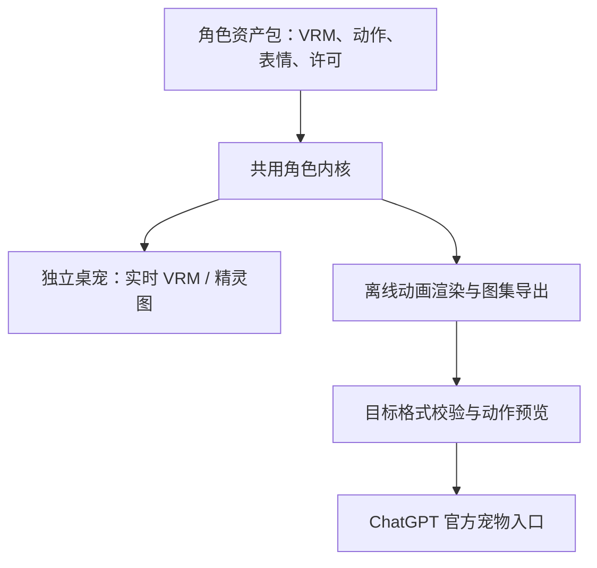

# OiGptPet 开发计划

更新日期：2026-10-22。已建立 0.1.0 开发原型，包含桌宠骨架、VRM 导入、动作预览与图集导出；ChatGPT 官方预检和安装尚未完成。具体进度以阶段记录为准，本文里程碑保留为整体目标。

## 1. 产品目标

制作一个可更换二次元角色的宠物项目，同时提供：

1. **独立 Windows 桌宠**：透明悬浮、拖动、缩放、鼠标互动、动作与表情、角色切换。
2. **ChatGPT 宠物版本**：把同一角色导出为目标应用支持的精灵图，通过官方入口安装或上传。

两个版本共享角色身份、配色、动作定义和源资产。首版的“双端兼容”指角色外观和动画资产兼容；实时同步位置、聊天记录或任务状态另行评估。

默认视觉方向：动漫赛璐璐风格，轮廓清楚、表情明显；先挑一个简洁的原创角色验证全流程。角色性别、发型、服装及正常比例或 Q 版比例可以后定。

## 2. 接入边界与首要验证

官方 Pets 文档介绍了自定义宠物和精灵图上传入口，目前未据此确认能直接加载 `.vrm` 或 Live2D 模型。因此，设计采用“实时模型 + 离线导出精灵图”两条输出路径。[官方 Pets 文档](https://learn.chatgpt.com/docs/pets)

需要分别处理三个目标：

| 目标 | 实现路径 | 首版范围 |
| --- | --- | --- |
| 独立桌面显示角色 | Electron 窗口内实时渲染 VRM，兼容精灵图播放 | 必做 |
| ChatGPT 显示同一角色 | 导出目标版本精灵图，经官方入口安装并实际验收 | 必做 |
| 独立桌宠和 GPT 对话 | 单独的对话服务适配层，届时选择 API、凭据与上下文方案 | 后续版本 |
| 同步 ChatGPT 的任务状态 | 仅在目标应用有文档化事件或扩展接口时接入 | 待验证 |

安装自定义外观不会自动为独立程序提供 ChatGPT 的登录态、历史聊天或任务事件。本项目也不以修改应用安装文件为集成方式。

当前环境的 Pets 插件只代表本次宿主环境提供的能力，不能假设独立发布的 Electron 应用天然拥有相同工具和权限。首版必须提供可独立交付的导出文件与安装说明；自动安装是可选增强。

## 3. 模型选择

### 首版推荐：VRM + 卡通渲染

VRM 是适合人形角色互通的格式；VRoid Studio 提供免费角色制作工具及 VRM 导出，适合从原创角色起步。Web 渲染可使用 Three.js 与 pixiv 的 `@pixiv/three-vrm`。[VRM 介绍](https://vrm.dev/en/vrm/vrm_about/)、[VRoid Studio](https://vroid.com/en/studio)、[three-vrm](https://github.com/pixiv/three-vrm)

| 方案 | 与本项目的匹配点 | 主要代价 | 排期 |
| --- | --- | --- | --- |
| VRM | 动漫人形资源入口明确；模型、骨骼和表情可用于实时显示及导出 | 要处理骨骼差异、头发物理、遮挡及动作适配 | 首版主线 |
| Live2D | 适合偏二维立绘的动漫表现，有官方样例与创作者资源 | 模型参数差异；SDK 发布条件需先核对 | 后续渲染器 |
| PNG/WebP 精灵图 | 同一套动画可供桌宠播放及目标宿主使用 | 动作与视角预先固定 | 首版兼容及低负载模式 |
| PMX/MMD 等 | 可作为未来资源转换入口 | 材质、物理、骨骼及授权适配范围更大 | 首版不支持 |

Live2D 官方提供学习和集成测试用样例。对支持用户加载模型的应用，还需核对其 Expandable Applications 条款和适用分类，再决定公开发布方式。[Live2D 样例](https://www.live2d.com/en/learn/sample/)、[Expandable Applications](https://www.live2d.com/en/sdk/license/expandable/)

### 资源获取策略

1. **首个验证角色：VRoid Studio 自制原创角色。** 使用自有或条款明确的素材，减少共享演示、动画导出和发布时的不确定性。
2. **角色扩充：BOOTH。** 搜索 `VRM オリジナル`、`VRM 無料`、`VRoid モデル`；核对商品是否真正提供 `.vrm`，避免把服装贴图或其他平台专用文件当作完整模型。[BOOTH 资源入口](https://booth.pm/)
3. **更多角色：VRoid Hub。** 只选择作者允许第三方使用且提供下载的模型；能在线查看不代表能下载。[VRoid Hub 下载说明](https://vroid.pixiv.help/hc/en-us/articles/360011744473-I-can-t-download-model-data)
4. **二维风格扩展：Live2D 官方样例及 BOOTH 的通用模型。** 先做兼容验证，再决定是否采购。

每个角色记录作者、原始链接、许可文本与获取日期；分别核对个人使用、模型修改、渲染图片/动画导出、向目标平台上传、源模型再分发及衍生精灵图再分发。源模型许可与渲染产物许可分别处理。

未明确允许再分发的模型由用户本地导入，不随仓库或安装包分发。免费和可下载均不能作为再分发许可。具体角色在实现阶段选定，当前不购买或绑定某一资源。

## 4. 双端技术架构



推荐技术栈为 **Electron + TypeScript + Vite + Three.js + @pixiv/three-vrm**；设置界面可使用 React。Electron 官方提供透明窗口及鼠标穿透相关能力，首个原型要在目标 Windows 环境验证实际表现。[BrowserWindow](https://www.electronjs.org/docs/latest/api/browser-window)、[窗口交互](https://www.electronjs.org/docs/latest/tutorial/custom-window-interactions)

| 模块 | 职责 |
| --- | --- |
| 角色内核 | 角色信息、动作时间轴、状态切换、表情映射；不依赖 Electron 或 ChatGPT |
| VRM 渲染器 | 加载模型、规范化骨骼、卡通材质、视线、表情及资源释放 |
| 精灵图渲染器 | 播放导出图集；让双端共用的动画也能在独立桌宠中验收 |
| 桌面宿主 | 透明置顶窗口、拖动、命中区域、托盘、快捷键、显示器及 DPI 适配 |
| 导出器 | 固定镜头、共享缩放和基线，按时间轴采样透明帧，组装目标图集 |
| 目标适配器 | 按格式版本定义行序、帧数、尺寸及校验；输出安装说明与报告 |

先使用简单本地动作和程序控制的呼吸、眨眼、视线及挥手，减少动作资源依赖。外部动画导入与重定向留到主流程稳定后；VRM 规范化骨骼也不能保证任意模型动作完全一致。

建议目录，实施时再创建：

```text
apps/desktop/                  独立桌宠、设置和托盘
packages/character-core/       角色定义与状态机
packages/renderer-vrm/         VRM 渲染及表情适配
packages/renderer-sprite/      图集播放
packages/pet-exporter/         动画采样与目标图集组装
packages/target-chatgpt/       版本配置、验证及导入指引
assets/demo/                  允许分发的演示资源及许可
docs/                         计划、资源记录和安装指南
```

首版仅保证已验收的 VRM 1.0 模型；旧版 VRM 0.x 的兼容性单独记录。角色包使用项目自定义清单，包含源文件、版本、表情能力、动作映射、缩放、地面基线、署名与许可引用。缺失可选表情时降级；无法安全导出的角色说明具体原因。

## 5. ChatGPT 动画导出规格

这里存在需要实测的版本差异：公开网页上传说明目前列出 `1536 × 1872`；当前已安装的 `work-pets:create-pet` 技能要求新宠物使用 v2，即 `1536 × 2288`。应建立两个格式配置，并以目标入口和验证器的实际结果确定兼容范围，不把两个入口视为相同接口。[网页上传规格](https://learn.chatgpt.com/docs/pets)

当前本地插件的规格依据：`work-pets/0.1.6/references/sprite-sheet-contract.md`。它是当前插件版本的契约，发布前应复核，不能当作永久通用协议。

| 配置 | 图集 | 单格 | 有效帧 | 用途 |
| --- | --- | --- | --- | --- |
| v2 | 1536 × 2288，8 列 × 11 行 | 192 × 208 | 73 | 当前插件新宠物主目标 |
| v1 | 1536 × 1872，8 列 × 9 行 | 192 × 208 | 57 | 文档所列网页上传目标，需实际验收 |

格式为透明 PNG 或 WebP，文件不超过 20 MiB；各版本均有 15 个空白格，必须完全透明。

| 行，从 0 起 | 状态 | 帧数 | 导出动作要求 |
| --- | --- | ---: | --- |
| 0 | idle | 6 | 呼吸、眨眼，平静且可辨认的循环 |
| 1 | running-right | 8 | 朝屏幕右侧的移动动作 |
| 2 | running-left | 8 | 朝屏幕左侧的移动动作 |
| 3 | waving | 4 | 清楚的挥手问候 |
| 4 | jumping | 5 | 实际离地并回到原基线 |
| 5 | failed | 8 | 可辨认的失败反应 |
| 6 | waiting | 6 | 等待用户输入或决策 |
| 7 | running | 6 | 工作或思考；与左右奔跑动作分开 |
| 8 | review | 6 | 检查、审阅的动作 |
| 9、10，仅 v2 | look directions | 16 | 身体锚定，头部/眼睛向 16 个方向看 |

视线从屏幕上方 0° 开始，顺时针每 22.5° 一格。它表示看向不同方向，不能用角色全身转台替代；固定镜头，通过头、颈和眼睛控制视线。

导出必须做到：所有动作共用缩放和站立基线；跳跃保留垂直位移；头发、衣摆不裁切；不把对话框或桌面阴影烘焙进角色图集。v1 可以从已验证 v2 的前九行导出，但需重新验证最终编码文件。

输出包括目标精灵图、联系表、逐状态动图、全部状态预览、跳跃衔接预览、视线方向预览及校验报告。通过当前目标验证器后，再用官方入口安装并观察宿主实际播放。格式校验通过与成功安装分别记录。

MCP 创建和选择宠物的流程由有权限的宿主执行；独立桌宠默认导出文件并提供指引。需要自动化时再封装宿主内可用的技能或插件，按当时上传契约完成验证、创建和结果核验。桌面端与网页端分别验收，不假定自动同步。

## 6. 开发里程碑

预计由一人全职投入 **约 3–5 周**，包含集成缓冲；以已有可用模型为前提。角色精修、外购素材等待、AI 对话、语音及外部平台审核不计入。各项是工作量估算，不是既有能力承诺。

| 阶段 | 预计工作量 | 交付内容 | 完成标准 |
| --- | --- | --- | --- |
| M0：双端可行性验证 | 2–3 天 | 目标应用/入口/格式记录；VRM 加载、透明帧输出；合法样例导入验证 | 确认目标入口实际可用；记录可接受格式；模型到透明帧链路可运行 |
| M1：独立桌宠骨架 | 3–4 天 | 透明置顶、拖动缩放、托盘退出、位置保存、鼠标互动 | 在目标 Windows 机器可用；空白区穿透；有明确的恢复互动快捷键 |
| M2：角色和动作内核 | 3–5 天 | 至少两个角色切换；表情能力检查；九种状态和十六方向视线 | 两个模型通过能力检查；切换释放旧资源；预览动作语义正确 |
| M3：双端导出与安装 | 4–6 天 | v2 导出、必要的 v1 导出、预览、结构/质量检查、安装指引 | 同一角色在独立桌宠与用户指定 ChatGPT 入口运行；保留验证与安装证据 |
| M4：稳定性及发布包 | 2–3 天 | 安装包、许可清单、导入错误提示、多屏/DPI与性能检查 | 新安装环境可启动；角色切换稳定；测试结果及已知限制可查 |

M0 结束前不把“可接入 ChatGPT”标为已实现。若目标账户入口缺失或版本不兼容，优先确认可用的官方路径并调整适配器；可以继续开发桌宠，但整个双端首版仍未完成。

## 7. 首版验收清单

- [ ] 一个有明确使用许可的动漫角色在 Windows 桌面独立运行。
- [ ] 用户能从本地导入另一个已支持版本的 VRM，并切换回原角色。
- [ ] 透明、拖动、缩放、置顶、鼠标穿透与恢复、托盘退出、重启位置恢复正常。
- [ ] 同一个角色的九类状态与十六方向视线可在导出预览中辨认。
- [ ] 最终图集的尺寸、透明度、空白格、帧数、体积、裁切、基线及跳跃衔接检查通过。
- [ ] 对精确待安装文件运行目标验证；保存报告并标识文件哈希，修改后重新验证。
- [ ] 在用户实际使用的 ChatGPT 入口完成安装，并观察空闲、可触发的任务状态及视线表现；未能触发的状态单独说明。
- [ ] 如果宣称网页和桌面都支持，两边分别有实际验证记录。
- [ ] 连续切换角色二十次、运行一小时，检查崩溃、显存/内存持续增长和卡死。
- [ ] 在记录硬件配置的目标机器上检查 30 FPS 目标、闲置降帧、隐藏后暂停；记录 CPU/GPU/内存实测值。
- [ ] 检查多屏、负坐标、100%/150%/200% 缩放、显示器拔插和休眠恢复；窗口不永久丢失。
- [ ] 安装包仅附带允许分发的资产；资源来源和使用条件可查。

运行时安全基线：渲染进程不开启 Node 集成；通过受限 preload/IPC 暴露必要能力；导入文件做类型、大小、路径与外部资源检查；本地导出默认不上传模型。后续加入对话时，凭据放入系统凭据存储并限制服务调用权限。

## 8. 后续版本

1. **对话陪伴**：独立对话适配器、文本气泡、回复触发表情；明确独立桌宠的会话与目标应用会话之间的边界。
2. **声音与口型**：按需加入语音输入、朗读及音量驱动口型。
3. **Live2D 渲染器**：确认资源和 SDK 发布条件后接入，共用角色接口与图集导出流程。
4. **外部动作**：增加适当格式的动画导入、重定向、模型能力报告与更多角色模板。
5. **状态联动**：仅使用已确认的官方接口或用户授权的本地开发工具事件；与基础外观兼容分开发布。

首个可交付版本的终点是：**一个二次元角色可以在独立桌面互动，也能导出并实际安装为 ChatGPT 宠物，另一角色可以复用同一套流程。**
